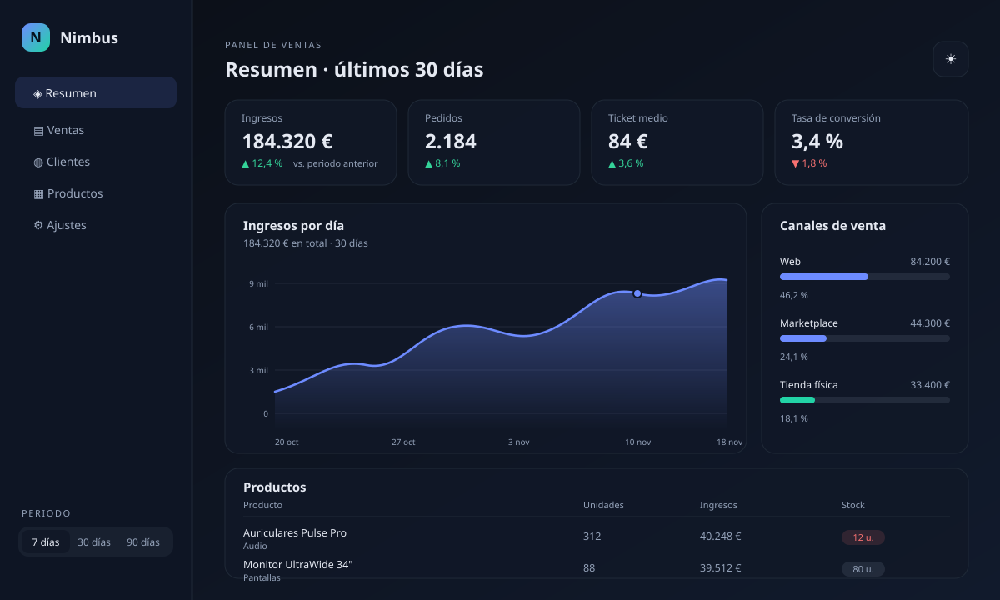

# Nimbus · Panel de analítica de ventas

> Dashboard de ventas con React 18 y TypeScript. Gráficos SVG propios, tema claro/oscuro, tabla ordenable y 19 tests.




---

## ✨ Qué demuestra

| Área | Implementación |
|---|---|
| ⚛️ **React + TypeScript** | Componentes tipados, props explícitas, `strict` + `noUnusedLocals` |
| 📈 **Gráfico propio** | Área y línea en SVG puro, sin librerías de charting (0 kB extra) |
| 🖱️ **Interacción** | Tooltip siguiendo el cursor y navegación con flechas del teclado |
| ♿ **Accesibilidad** | Tabla equivalente `sr-only`, `aria-sort`, `aria-pressed`, skip link, foco visible |
| 🌗 **Tema claro/oscuro** | Tokens CSS y preferencia persistida en `localStorage` |
| 🔄 **Carga con estado** | Hook con `AbortController`, skeletons, error con reintento y cancelación |
| 🔍 **Tabla de datos** | Búsqueda, orden por columna, `aria-sort` y estado vacío |
| 🧪 **Testing** | Vitest + Testing Library: lógica de formato, API, tabla y flujo completo de la app |
| 📱 **Responsive** | Grid fluido, sidebar colapsable y tabla con scroll horizontal |

---

## 🚀 Puesta en marcha

```bash
git clone https://github.com/HazSy/nimbus-dashboard.git
cd nimbus-dashboard

npm install
npm run dev        # http://localhost:5173
npm test           # 19 tests
npm run build      # build de producción en dist/
```

Para ver el estado de error: <http://localhost:5173/?error=1>

---

## 🗂️ Estructura

```
src/
├── components/
│   ├── Sidebar.tsx            # Navegación y selector de periodo
│   ├── KpiCard.tsx            # Tarjeta de métrica con variación
│   ├── RevenueChart.tsx       # Gráfico SVG + tooltip + tabla accesible
│   ├── ChannelBreakdown.tsx   # Barras por canal
│   ├── ProductsTable.tsx      # Tabla con búsqueda y orden
│   ├── DashboardSkeleton.tsx  # Estado de carga
│   └── ErrorState.tsx
├── hooks/
│   ├── useDashboard.ts        # Fetch cancelable + reintento
│   └── useTheme.ts            # Tema persistente
├── lib/
│   ├── api.ts                 # Capa de datos simulada (misma forma que una API real)
│   └── format.ts              # Formateo es-ES (moneda, %, fechas)
├── styles/global.css          # Tokens, layout y componentes
└── types.ts
```

### Sustituir los datos por una API real

`src/lib/api.ts` expone `fetchDashboard(range, signal): Promise<DashboardData>`. Basta
con reemplazar el cuerpo por:

```ts
const res = await fetch(`/api/dashboard?range=${range}`, { signal });
if (!res.ok) throw new Error("No se pudo cargar el panel");
return res.json();
```

El resto de la aplicación no cambia: los componentes solo conocen `DashboardData`.

---

## 🧠 Decisiones técnicas

- **Sin librería de gráficos.** El área se calcula con una función de escala y un `path`
  SVG; así el bundle final queda en ~52 kB gzip y el gráfico hereda los tokens de color
  del tema.
- **Capa de datos aislada.** La UI no sabe si los datos vienen de un mock o de un backend,
  y los tests pueden inyectar respuestas controladas.
- **Cancelación real.** Cada cambio de rango aborta la petición anterior, evitando
  condiciones de carrera al cambiar rápido entre 7 / 30 / 90 días.
- **Accesibilidad primero.** El gráfico incluye una tabla de datos para lectores de
  pantalla; la tabla usa `aria-sort` y los botones de orden son accesibles por teclado.
- **Números en español.** Se usa `Intl.NumberFormat("es-ES")`, con el detalle de que los
  números de cuatro cifras no llevan separador de millares (norma RAE/ICU).

---

## 🧪 Tests

```
✓ src/lib/format.test.ts        (5)  formato de moneda, %, fechas y unidades
✓ src/lib/api.test.ts           (5)  determinismo, abort, error simulado, canales
✓ components/ProductsTable.test (5)  orden, búsqueda, stock bajo, estado vacío
✓ src/App.test.tsx              (4)  carga, cambio de rango, error + retry, tema
```

---

## 🗺️ Roadmap

- [ ] Exportar el periodo a CSV
- [ ] Comparación contra el periodo anterior en el mismo gráfico
- [ ] Filtros por canal que afecten a todos los widgets
- [ ] Virtualización de la tabla para catálogos grandes
- [ ] Tests E2E con Playwright

---

## 👤 Autor

**Oscar López Pellicer** — Estudiante de Desarrollo de Aplicaciones Web (Murcia, España)

[](https://github.com/HazSy)

Licencia [MIT](./LICENSE).
